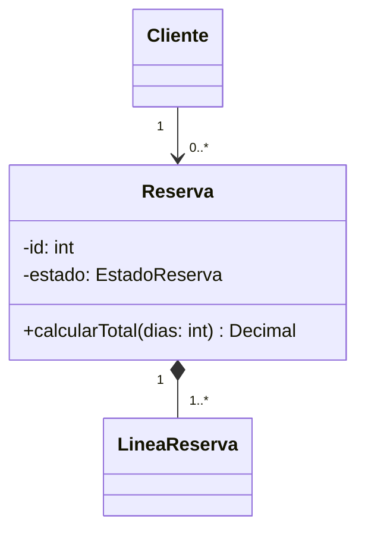

# Diseño de software — estándares de Nicolás Cano Leal

> Contexto de origen: asignatura **Diseño de Software (IEI-050)**, Universidad
> Santo Tomás, docente Giovanni Cáceres R. Lo que se evalúa ahí es
> **modelado**, no implementación: un error de notación o de categoría cuesta
> nota y es trivial de detectar para quien corrige. Estas reglas sirven igual
> en un proyecto profesional, donde el costo no es la nota sino el rediseño.

Esta skill cubre el **diseño**. La implementación de ese diseño vive en
[[arquitectura-java]] y [[python-backend]]; el despliegue, en [[docker]],
[[kubernetes]], [[terraform]], [[github-actions]] y [[jenkins]].

---

## 1. Precisión terminológica — el error que más caro sale

Confundir estas categorías es error de **categoría**, no de detalle. La
pregunta que desambigua siempre: *¿esto estructura todo el desarrollo, lo
ejecuta, o es una herramienta puntual dentro de él?*

| Término | Categoría | Qué es | Uso correcto |
|---|---|---|---|
| **Iterativo-incremental** | Modelo de ciclo de vida | Ciclos repetidos (iteraciones) + entregas parciales de funcionalidad (incrementos) | "El proyecto usa un modelo iterativo-incremental para absorber cambios de requisitos." |
| **Cascada** | Modelo de ciclo de vida | Secuencial: Análisis → Diseño → Implementación → Pruebas → Despliegue. Sin iteración | "Cascada es inadecuado: el cliente aún no clarifica todos los requisitos." |
| **Espiral** | Modelo de ciclo de vida | Iterativo guiado por **análisis de riesgo** en cada vuelta | "Espiral se justifica cuando el riesgo técnico domina la planificación." |
| **Scrum** | Marco de gestión | Roles, eventos y artefactos que **implementan** un modelo iterativo. No es un ciclo de vida | "Scrum implementa el modelo iterativo-incremental mediante sprints de 2 semanas." |
| **Kanban / XP** | Marco de gestión | Otras formas de ejecutar el mismo modelo | — |
| **Prototipado** | Técnica de ingeniería de requisitos | Versión simplificada (típicamente interfaz) para validar requisitos antes de comprometerlos | "El prototipado permite al cliente ajustar requisitos temprano." |
| **TDD / pair programming** | Técnica | Herramientas dentro del proceso | — |

**Regla de oro**: *modelo* = estructura de alto nivel · *marco* = cómo se
ejecuta ese modelo · *técnica* = herramienta puntual dentro del proceso.

```
❌ "Usaremos la metodología Scrum como ciclo de vida."
❌ "El modelo de prototipado."                  (prototipado no es un modelo)
✅ "Modelo iterativo-incremental, gestionado con Scrum, usando prototipado
    de interfaz para validar requisitos en las dos primeras iteraciones."
```

**Justificar siempre por la propiedad del problema, no por moda.** El
argumento válido es la estabilidad de los requisitos, el riesgo, o la
necesidad de feedback temprano — nunca "es lo más usado hoy".

---

## 2. SOLID — los dos que casi nadie aplica bien

Los cinco importan, pero SRP y OCP se citan de memoria y LSP/ISP se
malinterpretan. Ahí está el valor real.

**S — Responsabilidad única.** Una clase cambia por **una sola razón**. El
test práctico: si al describir la clase necesitas "y", probablemente son dos.
`Reserva` que calcula tarifas *y* envía correos tiene dos motivos de cambio
(política comercial, proveedor de correo).

**O — Abierto/cerrado.** Extender sin modificar. En la práctica: si agregar un
medio de pago obliga a tocar un `switch` existente, el diseño está cerrado a
la extensión. La solución típica es polimorfismo o Strategy — pero **solo
cuando la variación ya se manifestó dos veces**, no anticipándola.

**L — Sustitución de Liskov.** El subtipo debe poder reemplazar al padre **sin
romper las expectativas de quien llama**. Es el más sutil:

```
❌ class Cuadrado extends Rectangulo { setAncho(a) { this.ancho = this.alto = a; } }
   // Un test que hace setAncho(5); setAlto(4); y espera area()==20 falla con Cuadrado.
   // Cuadrado "es un" rectángulo en geometría, pero NO es un subtipo válido
   // del rectángulo MUTABLE: rompe el contrato de quien llama.
✅ Modelar ambos como implementaciones inmutables de una interfaz Figura
   con area(), sin herencia entre ellos.
```

Señal de alarma: un subtipo que lanza `UnsupportedOperationException`, o que
endurece precondiciones (acepta *menos* que el padre). "Es un" en lenguaje
natural no basta: el criterio es el **contrato observable**.

**I — Segregación de interfaces.** Mejor varias interfaces pequeñas que una
gorda. Si una implementación deja métodos vacíos o lanzando "no aplica", la
interfaz estaba mal cortada.

**D — Inversión de dependencias.** Depender de abstracciones. El módulo de
alto nivel define **qué** necesita; el de bajo nivel lo implementa. Concreto:
el servicio de reservas declara `RepositorioVehiculos` (interfaz) y no importa
el ORM. Eso es lo que permite testear la regla de negocio sin base de datos.

---

## 3. Patrones GoF — el antipatrón es usarlos de más

**Regla dura: un patrón se introduce cuando el problema ya apareció, no
antes.** Un diseño de estudiante con Factory + Singleton + Observer en tres
clases se corrige peor que uno simple y correcto. El profesor —y cualquier
revisor— ve la sobreingeniería antes que la elegancia.

Los que sí ganan su lugar seguido:

| Patrón | Tipo | Cuándo | Señal de que lo necesitas |
|---|---|---|---|
| **Strategy** | Comportamiento | Varios algoritmos intercambiables | Un `switch`/`if` por tipo que crece con cada requisito nuevo |
| **Observer** | Comportamiento | Un hecho dispara efectos que no deben acoplarse | "Cuando pasa X hay que avisar a A, B y mañana a C" |
| **State** | Comportamiento | Un objeto cambia de comportamiento según su estado | Máquina de estados con transiciones inválidas que hay que prohibir |
| **Factory Method** | Creacional | La creación tiene reglas propias | Constructores con lógica de decisión adentro |
| **Adapter** | Estructural | Integrar algo externo con interfaz incómoda | Envolver una librería de terceros |
| **Repository** | (no GoF) | Aislar la persistencia del dominio | Querer testear reglas sin base de datos |

**Singleton: casi siempre es la respuesta equivocada.** Es estado global
disfrazado: rompe los tests (el estado se filtra entre casos), esconde
dependencias (nadie ve en la firma que la clase usa esa instancia) y complica
la concurrencia. Si hace falta una sola instancia, que lo decida quien
compone la aplicación (inyección de dependencias), no la clase misma.

**Nombrar por intención, no por patrón.** `CalculadoraTarifa` se lee mejor que
`TarifaStrategyImpl`. El patrón es un medio, no parte del vocabulario del
dominio.

---

## 4. UML — es un lenguaje formal, no un dibujo

Un diagrama con notación incorrecta comunica algo **falso**. Los errores de
abajo son los que aparecen una y otra vez.

### 4.1 Diagrama de clases

**Multiplicidad: se lee cruzada.** El número junto a un extremo dice cuántos
objetos de **ese** lado participan por cada objeto del otro.

```
Cliente 1 ────── 0..* Reserva
```
Se lee: *un* cliente tiene *cero o muchas* reservas; *cada* reserva pertenece
a *exactamente un* cliente. Escribirlo al revés es el error #1 y cambia el
modelo por completo.

Valores válidos: `1`, `0..1`, `1..*`, `0..*` (o `*`), `2..5`. **Nunca dejar un
extremo sin multiplicidad**: no significa "1", significa "no especificado", y
se penaliza como omisión.

**Agregación vs composición** — el otro error clásico:

| | Rombo | Significado | Prueba decisiva |
|---|---|---|---|
| **Agregación** | ◇ blanco | "tiene un", partes con vida propia | Si borro el todo, ¿la parte sigue teniendo sentido? **Sí** |
| **Composición** | ◆ negro | "está compuesto de", la parte muere con el todo | Si borro el todo, ¿la parte sigue teniendo sentido? **No** |

```
Universidad ◇── Profesor      (el profesor existe sin la universidad)
Reserva     ◆── LineaReserva  (una línea sin su reserva no significa nada)
```

En la duda, usar **asociación simple** (línea sin rombo). Una asociación
correcta vale más que una composición mal puesta.

**Otras reglas:**
- **Navegabilidad**: la flecha indica quién conoce a quién. Sin flecha =
  bidireccional. Si `Reserva` conoce a `Vehiculo` pero no al revés, la flecha
  va hacia `Vehiculo` — y eso debe coincidir con el código.
- **Herencia**: triángulo hueco hacia el padre. Solo si hay verdadera
  sustitución (ver Liskov, §2). Preferir composición.
- **Visibilidad**: `+` público, `-` privado, `#` protegido, `~` paquete.
  Atributos privados por defecto.
- **Estereotipos** entre `«guillemets»`: `«interface»`, `«abstract»`,
  `«enumeration»`. No inventar estereotipos sin definirlos.
- **Firmas completas**: `+ calcularTotal(dias: int): Decimal`. Un método sin
  tipo de retorno ni parámetros es un diagrama a medio hacer.

### 4.2 Diagrama de secuencia

- **Línea de vida** punteada bajo cada participante; **barra de activación**
  (rectángulo) mientras el objeto ejecuta. Omitir las barras es el error más
  frecuente.
- **Flecha sólida con punta cerrada** = llamada síncrona. **Flecha abierta** =
  asíncrona. **Punteada** = retorno. Usar la misma flecha para todo borra la
  información que el diagrama existía para dar.
- **Fragmentos combinados** para lógica: `alt` (alternativa), `opt`
  (opcional), `loop` (repetición), `par` (paralelo). Un `if` dibujado como
  comentario al margen no es notación válida.
- **Un escenario por diagrama.** El camino feliz y el de error van separados,
  o en un `alt` explícito — no mezclados sin marcar.

### 4.3 Casos de uso

**`«include»` vs `«extend»` se confunden casi siempre:**

- **`«include»`**: el caso base **siempre** ejecuta el incluido. Es
  factorización de algo obligatorio y común. Flecha del **base → incluido**.
  *Ej.: "Registrar pago" incluye "Validar sesión".*
- **`«extend»`**: comportamiento **opcional/condicional** que se inserta en un
  punto de extensión. Flecha del **extensión → base** (al revés que include).
  *Ej.: "Aplicar descuento" extiende "Registrar pago".*

Regla mnemotécnica: *include siempre pasa, extend a veces; y sus flechas
apuntan en direcciones opuestas.*

- Los actores son **roles**, no personas ni cargos: `Cliente`, `Operador`.
- Un caso de uso es un **objetivo del actor con valor observable**, no un paso
  de UI. ❌ "Hacer clic en Guardar" · ✅ "Registrar una reserva".
- El actor va **fuera** del límite del sistema; los casos de uso, dentro.

### 4.4 Herramientas

**StarUML** o **Visio** para lo entregable (son las que nombra el docente).
Para diagramas versionables junto al código, **Mermaid** (se renderiza en
GitHub y en artifacts) o **PlantUML**:

````markdown

````

Ventaja de Mermaid/PlantUML: el diagrama vive en el repo, entra en el
*diff* y no se desincroniza en silencio como un `.png` exportado.

---

## 5. El puente diseño → código

Un diagrama que no se corresponde con el código es documentación falsa. Al
implementar, verificar la traducción:

| En UML | En código |
|---|---|
| Multiplicidad `0..*` | Colección (`List<T>`, `related_name` en Django) |
| Multiplicidad `1` | Campo obligatorio, no nulo, validado |
| Composición ◆ | Borrado en cascada; la parte no se crea sin el todo |
| Agregación ◇ | Referencia; borrar el todo no borra la parte |
| `«interface»` | `interface`/`Protocol`/clase abstracta |
| Navegabilidad unidireccional | Solo un lado tiene el atributo — si ambos lo tienen, el diagrama miente |

**Después de cambiar el código, auditar el diagrama.** Es exactamente la misma
regla que [[cierre-de-tarea]] aplica a la documentación: un modelo obsoleto es
peor que uno ausente, porque alguien lo va a creer.

---

## 6. Antipatrones de diseño

- **God Object / clase Dios**: una clase que sabe y hace todo. Síntoma: el
  archivo más grande del repo y el que se toca en cada cambio.
- **Modelo anémico**: entidades que son solo bolsas de getters/setters, con
  toda la lógica en "servicios". El dominio queda sin comportamiento y las
  reglas se duplican. La lógica que pertenece a la entidad va en la entidad.
- **`utils`/`helpers` como cajón de sastre**: es donde va a morir el código
  que nadie supo dónde poner. Organizar por dominio (ver [[arquitectura-java]] §1).
- **Herencia por reutilización**: heredar para aprovechar código, no porque
  haya sustitución real. Rompe Liskov. Componer, no heredar.
- **Acoplamiento temporal**: métodos que deben llamarse en cierto orden sin
  que nada lo impida (`init()` antes de `run()`). Si el orden importa, que el
  tipo lo garantice (constructor completo, estados explícitos).
- **Sobreingeniería preventiva**: capas de abstracción para requisitos
  imaginarios. Se paga hoy y casi nunca se cobra.

---

## Checklist antes de entregar un diseño

- [ ] Términos usados en su categoría correcta (modelo / marco / técnica).
- [ ] Toda asociación tiene multiplicidad en **ambos** extremos.
- [ ] Composición ◆ solo donde la parte muere con el todo; en la duda,
      asociación simple.
- [ ] Navegabilidad coherente con lo que hará el código.
- [ ] Métodos con firma completa (parámetros tipados y tipo de retorno).
- [ ] `«include»`/`«extend»` con la flecha en el sentido correcto.
- [ ] Diagramas de secuencia con barras de activación y flechas diferenciadas.
- [ ] Cada patrón aplicado responde a un problema **ya presente**, y se puede
      justificar en una frase.
- [ ] Ningún God Object; ninguna clase que solo tenga getters y setters.
- [ ] El diagrama coincide con el código que existe hoy.

## Ver también

[[arquitectura-java]] para llevar este diseño a Java (records, contratos,
excepciones de dominio) · [[python-backend]] para el equivalente en Django/DRF
· [[docker]], [[kubernetes]] y [[terraform]] para empaquetar y desplegar lo
diseñado · [[github-actions]] / [[jenkins]] para el pipeline que lo valida ·
[[cierre-de-tarea]] para mantener los diagramas al día tras cada cambio.
